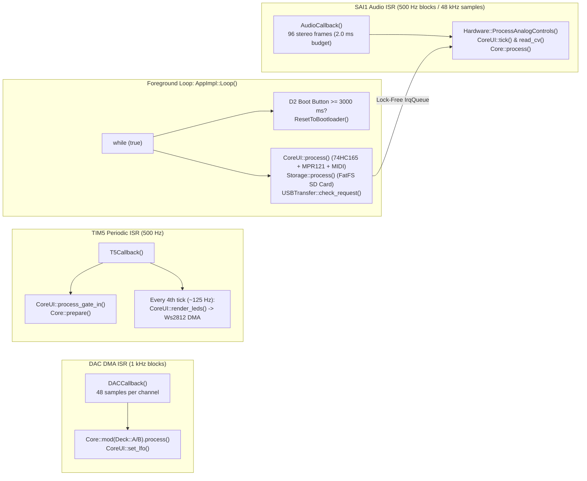

## 1. STM32H750 Memory Map (`alt_sram.lds` & `APP_TYPE = BOOT_SRAM`)

Spotykach compiles with `APP_TYPE = BOOT_SRAM` and custom linker script `alt_sram.lds`{{sidenote:Why custom `alt_sram.lds`? Vanilla `libDaisy` splits AXI SRAM differently; Spotykach reserves a full 256 KB for `SRAM_EXEC` (`.text` + `.rodata`) and 256 KB for `.bss`, while routing `.data` and `.dtcmram_bss` into zero-wait-state `DTCMRAM` at `0x20000000`.}}. The Daisy Bootloader (`bootloader-spotykach-v2.bin`) lives in the 128 KB internal flash (`0x08000000`), copies the firmware image from QSPI flash (`0x90040000`) into `SRAM_EXEC` (`0x24000000`) on boot, and jumps to `Reset_Handler`.

Table: STM32H750 memory regions configured in `alt_sram.lds`

| Linker Region | Start Address | Size | Section / Macro | Spotykach Role & Hardware Constraints |
| :--- | :--- | :--- | :--- | :--- |
| `FLASH` | `0x08000000` | 128 KB | Bootloader only | Houses `bootloader-spotykach-v2.bin`. Never overwritten by `make program-dfu`. |
| `DTCMRAM` | `0x20000000` | 128 KB | `.data`, `.dtcmram_bss`, `_estack` | 480 MHz zero-wait CPU RAM. **Cannot be accessed by DMA1/DMA2.** |
| `SRAM_EXEC` | `0x24000000` | 256 KB | `.isr_vector`, `.text`, `.rodata` | Executable firmware code and constants copied from QSPI at boot. |
| `SRAM` | `0x24040000` | 256 KB | `.bss`, `.heap`, `.reserved_for_stack` | Standard zero-initialised static objects (`app`, `impl`). Cached by D-Cache. |
| `RAM_D2` | `0x30000000` | 32 KB | `.sram1_bss` (`DMA_BUFFER_MEM_SECTION`) | **Non-cached DMA region** for `dac_buf[2][48]`, ADC DMA, and WS2812 PWM DMA. |
| `SDRAM` | `0xC0000000` | 64 MB | `.sdram_bss` (`DSY_SDRAM_BSS`) | External FMC SDRAM (`SDRAMBuffer`, dual 60 s stereo decks, `Flux` delay lines). |
| `QSPIFLASH` | `0x90000000` | 8 MB | `.qspiflash_*` / `PersistentStorage` | Non-volatile flash storing the `BOOT_SRAM` image (`0x90040000`) and calibration `Settings`. |

---

## 2. Complete Daisy Seed Pinout (`src/hw/hardware.cpp`)

Every hardware peripheral on the Spotykach main PCB connects to a specific pin on the Electro-Smith Daisy Seed module:

Table: Spotykach Daisy Seed pin mapping (`src/hw/hardware.cpp`)

| Subsystem | Daisy Seed Pin(s) | Direction / Bus | Hardware Notes & Signal Polarity |
| :--- | :--- | :--- | :--- |
| **Boot / Reset Button** | `seed::D2` | Digital In (`NOPULL`) | Active-low (`POLARITY_INVERTED`). Tap release resets MCU; $\ge 3000\text{ ms}$ hold enters DFU bootloader. |
| **Rear USB-C Port** | `seed::D29` (`D-`), `seed::D30` (`D+`) | `UsbHandle::FS_EXTERNAL` | External USB port used for DFU flashing, USB MIDI, and USB CDC sample transfer. |
| **WS2812 RGB LEDs (83x)** | `seed::D17` | `TIM_3` `CH4` PWM + `DMA2` | Single serial chain: pads, two 32-LED rings (`LED_RING_A`/`B`), mode LEDs, and faders. |
| **Clock Input** | `seed::D3` | Digital In (`NOPULL`) | NPN transistor buffer inverts signal on PCB: read via `!clock_in_.Read()`. |
| **Gate Inputs A & B** | `seed::D1` (A), `seed::D0` (B) | Digital In (`NOPULL`) | NPN transistor buffer inverts signal on PCB: read via `!gate_in_a_.Read()`. |
| **Gate Outputs A & B** | `seed::D31` (A), `seed::D32` (B) | Digital Out (`OUTPUT`) | Driven directly via `gate_out_a_.Write(state)` and `gate_out_b_.Write(state)`. |
| **74HC165 Shift Registers (2x)** | `D26` (`CLK`), `D27` (`DATA`), `D7` (`LOAD`) | Bit-banged SPI-like | Scans 16 toggle/slide switch bits across two cascaded 8-bit `CD74HC165` chips. |
| **MPR121 Touch Controller** | `seed::D11` (`SCL`), `seed::D12` (`SDA`) | `I2C_1` Master @ 400 kHz | Polls 12 capacitive pads (`PlayA`..`Alt`) as a 12-bit touch bitmask (`mpr121_.Touched()`). |
| **Analog Muxes (2x CD4051)** | `A9` (Mux 1), `A10` (Mux 2), `D8`–`D10` (Addr A/B/C) | `ADC1` (`OVS_32`) | Scans 14 Deck A/B pots plus the crossfader (`CTRL_CROSSFADE` on Mux 2 ch 7). |
| **Bipolar CV Inputs (7x)** | `A4`, `A11`, `A5`, `A3`, `A0`, `A6`, `A1` | `ADC1` (`OVS_32`) | `CV_SIZE_POS_A`, `CV_MIX_A`, `CV_V_OCT_A`, `CV_CROSSFADE`, `CV_SIZE_POS_B`, `CV_MIX_B`, `CV_V_OCT_B`. |
| **Modulation Outputs A & B** | Dedicated DAC 1 & 2 pins | 12-bit DMA DAC (`BOTH`) | Driven at 48 kHz (`kDacBufSize = 48`) using `__USAT(out * 4096, 12)`. |
| **TRS MIDI In / Out** | `seed::D14` (`RX`), `seed::D13` (`TX`) | `USART_1` @ 31,250 baud | Hardware TRS MIDI handled by `daisy::MidiUartHandler`. |

---

## 3. Execution Contexts & Real-Time Rules

1. **Never block in `AudioCallback`, `DACCallback`, or `T5Callback`**: `I2C1` transactions (`MPR121`), `FatFS` SD card reads (`Storage`), and `USBTransfer` packet I/O must only execute in `AppImpl::Loop()`.
2. **Custom `bleeptools/libDaisy` (`origin/sk`) Contract**:
   - `main.cpp` **must** define `const char* USBD_MANUFACTURER_STRING = "Synthux";` and `const char* USBD_PRODUCT_STRING_HS = "Spotykach";` at global scope so `libDaisy`'s `usbd_desc.c` links cleanly.
   - `src/hw/ws2812.cpp` relies on `TimerHandle::GetHALHandle()` and `hal_map.h` from the Infrasonic/Bleeptools fork.
